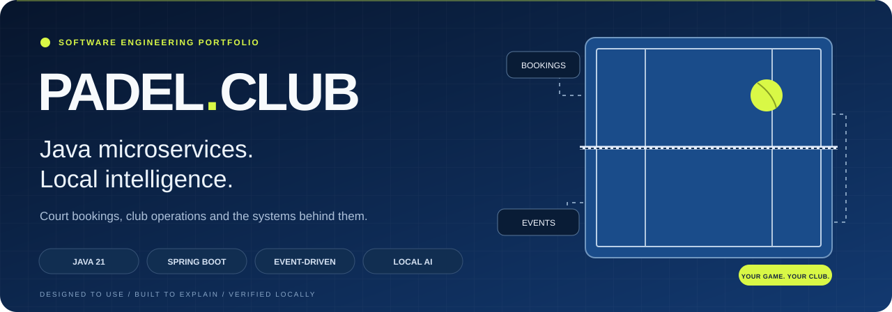
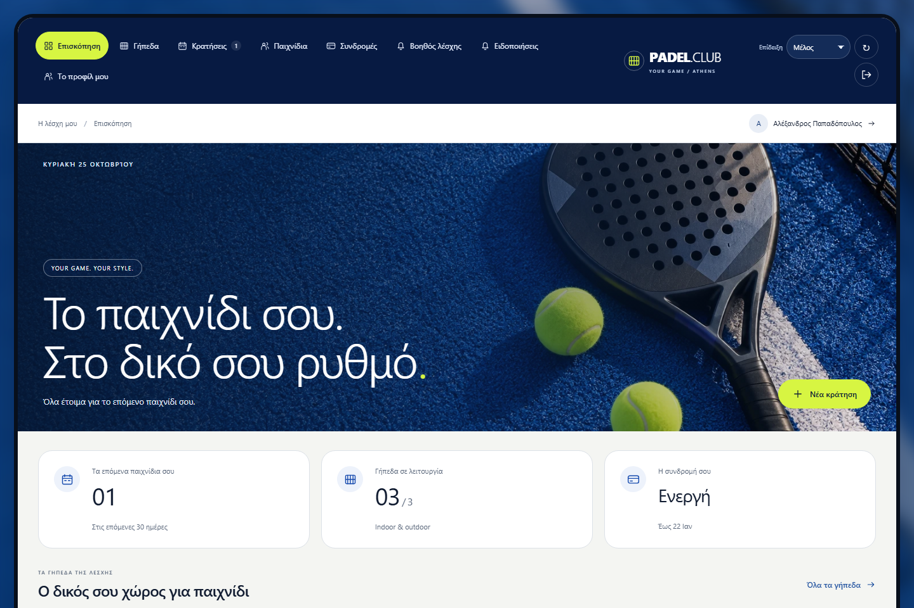
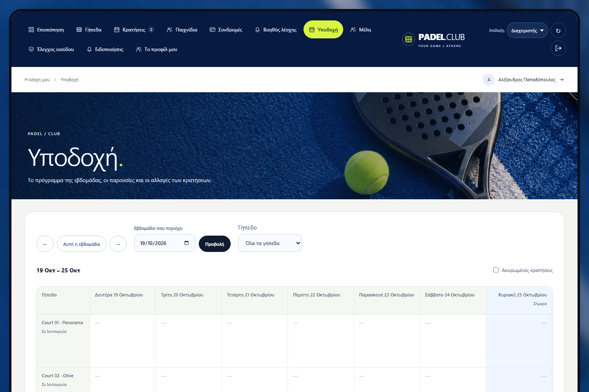
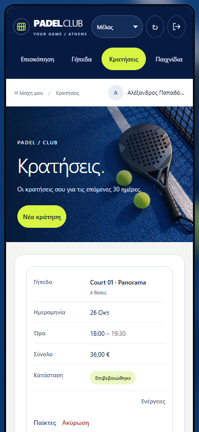
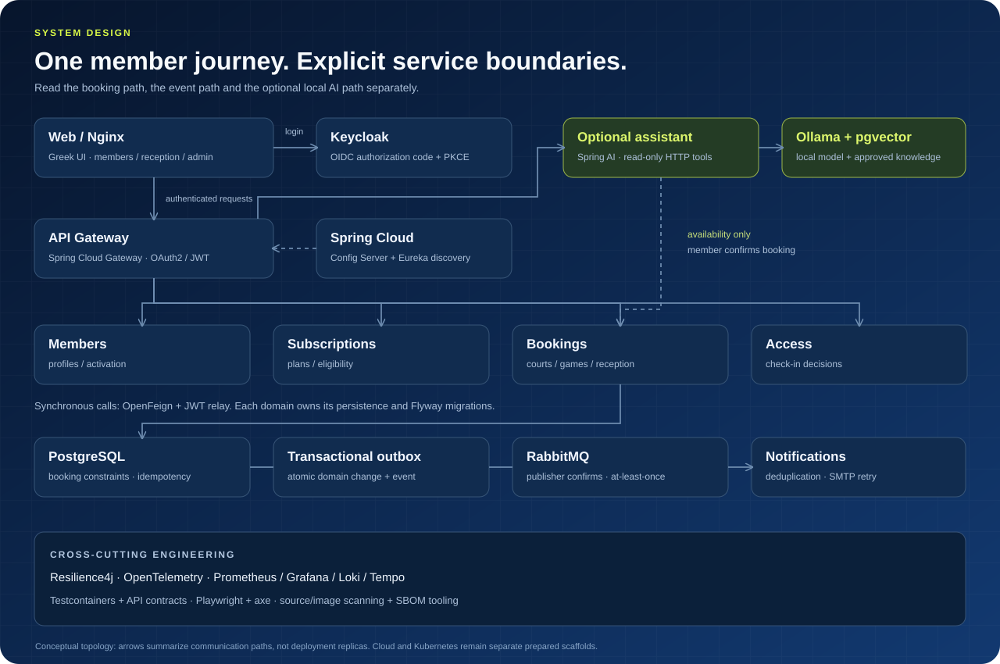
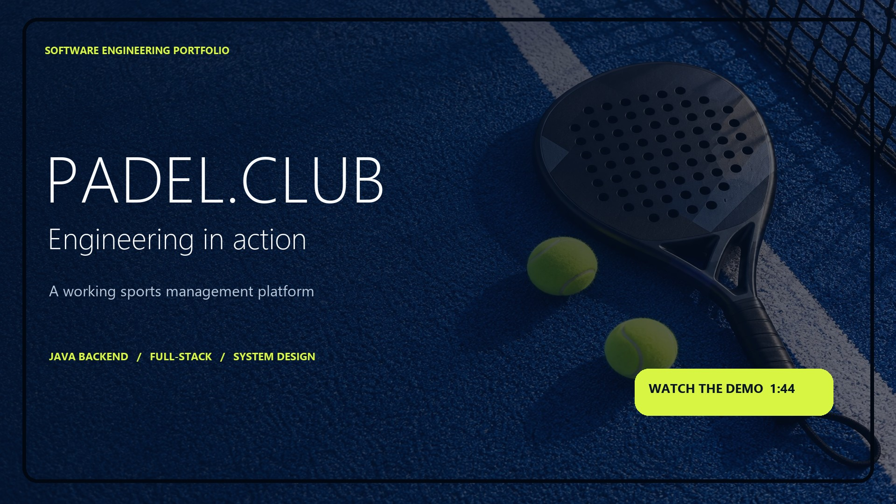

<p align="center">
  
</p>

<p align="center">
  <strong>A complete club experience, backed by explainable engineering.</strong><br />
  Court bookings · memberships · reception · notifications · a grounded local assistant
</p>

<p align="center">
  <a href="https://github.com/Stelios-developer/padel-club-management-platform/releases/tag/demo-v1">104-second demo</a> ·
  <a href="https://github.com/Stelios-developer/padel-club-management-platform/releases/tag/v1.0.0">Signed container release</a> ·
  <a href="#architecture">Architecture</a> ·
  <a href="#technology-in-context">Technology</a> ·
  <a href="#quick-start">Run locally</a> ·
  <a href="docs/README.el.md">Ελληνικός οδηγός</a>
</p>

<p align="center">
  <a href="pom.xml"></a>
  <a href="pom.xml"></a>
  <a href="backend/config-repo/"></a>
  <a href="docs/BOOKING-CONSTRAINT.md"></a>
  <a href="backend/common/src/main/java/club/padel/common/events/"></a>
  <a href="infra/keycloak/"></a>
</p>
<p align="center">
  <a href="docs/AI-ASSISTANT.md"></a>
  <a href="infra/ai/"></a>
  <a href="docs/BACKEND-QUALITY.md"></a>
  <a href="infra/observability/"></a>
  <a href="compose.yml"></a>
  <a href="LICENSE"></a>
</p>

---

[](https://github.com/Stelios-developer/padel-club-management-platform/actions/workflows/ci.yml)
[](https://github.com/Stelios-developer/padel-club-management-platform/actions/workflows/cloud.yml)
[](https://github.com/Stelios-developer/padel-club-management-platform/releases/tag/demo-v1)

## The product

**Padel Club** connects the member's next game with the club's daily operations. Members find a court, review the price, reserve a slot and invite players. Reception manages subscriptions, schedules, attendance and audited changes. A responsive Greek interface serves members, staff and administrators.

The harder guarantees live in the backend: PostgreSQL prevents overlapping reservations, persisted idempotency protects repeated requests, and an outbox connects committed business changes to asynchronous notifications. The optional AI assistant retrieves approved policies and searches live availability; the member confirms the booking.

<p align="center">
  
</p>

<table>
  <tr>
    <td width="50%"><strong>For the member</strong><br />Court availability, 60/90/120-minute slots, transparent pricing, invitations, open games, waitlists and weekly bookings.</td>
    <td width="50%"><strong>For reception</strong><br />Weekly calendar, member search, subscription activation, conflict-safe rescheduling, attendance and change history.</td>
  </tr>
</table>

<details>
<summary><strong>Explore reception and the mobile booking experience</strong></summary>

<p></p>
<p align="center"></p>

These screenshots use the current interface and synthetic browser-local demo data. The [real user journey](docs/results/frontend/folder-layout-2026-10-25.json) separately verifies public registration, identity, subscription, booking, notifications and a sourced AI response against the actual backend.

</details>

## What to inspect in the code

| Engineering problem                                   | Implementation                                                                                    | Start here                                                                                     |
| ----------------------------------------------------- | ------------------------------------------------------------------------------------------------- | ---------------------------------------------------------------------------------------------- |
| Two people reserve the same slot                      | PostgreSQL exclusion constraints, including protection from writers that bypass application locks | [Booking constraints](docs/BOOKING-CONSTRAINT.md)                                              |
| A client retries after losing the response            | Persisted fingerprint/response; idempotency, domain writes and outbox share a transaction         | [Idempotency](backend/common/src/main/java/club/padel/common/Idempotency.java)                 |
| The broker is unavailable after a transaction commits | Transactional outbox, publisher confirms and consumer deduplication; at-least-once delivery       | [Outbox publisher](backend/common/src/main/java/club/padel/common/events/OutboxPublisher.java) |
| A downstream service stalls                           | Resilience4j circuits/bulkheads, bounded HTTP budgets and Toxiproxy fault/recovery tests          | [Resilience evidence](docs/BACKEND-RESILIENCE.md)                                              |
| A user requests another member's records              | OIDC/PKCE, JWT validation and backend role/ownership enforcement                                  | [API access rules](docs/API.md)                                                                |
| An AI answer needs trustworthy evidence               | Approved knowledge, vector retrieval, typed read-only tools and explicit human confirmation       | [Assistant design](docs/AI-ASSISTANT.md)                                                       |
| A release image must match what was checked           | Image identity, SBOM binding and verified digest-bound provenance/SBOM attestations               | [Supply-chain workflow](docs/SUPPLY-CHAIN.md)                                                  |

## Architecture

<p align="center">
  
</p>

The Maven reactor owns nine Java runtime services, shared contracts and a consumer-contract module. Each domain owns its persistence and migrations. OpenFeign handles synchronous domain calls with the caller's JWT; RabbitMQ carries committed events. The optional assistant uses Spring AI/Ollama and pgvector, with a fixed read-only HTTP adapter for availability.

[Service ownership and invariants](docs/ARCHITECTURE.md) · [Code map](docs/CODE-MAP.md) · [API reference](docs/API.md)

## Technology in context

| Area                      | Technologies                                                               | Purpose                                                                                    |
| ------------------------- | -------------------------------------------------------------------------- | ------------------------------------------------------------------------------------------ |
| Backend                   | **Java 21 · Spring Boot 4.0.8 · Maven**                                    | Typed APIs, validation and transactional business rules                                    |
| Coordination              | **Spring Cloud 2025.1.3 · Gateway · Config · Eureka · OpenFeign**          | Routing, canonical configuration, discovery and domain calls                               |
| Data integrity            | **PostgreSQL 17 · Flyway · Spring Data JPA**                               | Service-owned data, migrations, exclusion constraints and idempotency                      |
| Messaging                 | **RabbitMQ · transactional outbox**                                        | Publisher confirms, deduplication and notification delivery retries                        |
| Identity                  | **Keycloak · OAuth2/OIDC · PKCE · JWT**                                    | Browser sign-in, roles and resource ownership                                              |
| Local AI                  | **Spring AI 2.0.1 · Ollama · pgvector · promptfoo**                        | Approved-policy retrieval, availability tools and regression evaluation                    |
| Resilience                | **Resilience4j · Toxiproxy**                                               | Bounded concurrency, circuit behavior and real fault/recovery tests                        |
| Observability             | **OpenTelemetry · Prometheus · Grafana · Loki · Tempo**                    | Instrumentation, metrics, dashboards, logs and traces                                      |
| Verification              | **JUnit · Testcontainers · Spring Cloud Contract · Playwright · axe-core** | Business/security rules, real dependencies, API contracts and browser/accessibility checks |
| Web                       | **Native JavaScript modules · CSS · Nginx**                                | Responsive Greek UI, isolated demo and explicit session/data lifecycle guards              |
| Delivery                  | **Docker · GitHub Actions · CodeQL · Trivy · Syft**                        | Reproducible builds, CI analysis, policy gates and SBOM inventory                          |
| Local orchestration       | **Kubernetes · kind · Kustomize**                                          | Nine signed app images, probes, StatefulSets/PVCs and actual pod/database recovery tests   |
| Prepared cloud deployment | **Terraform/AWS**                                                          | Configuration, mock checks and guarded workflows; AWS deployment remains separate work     |

Versions and pins live in the [POM](pom.xml), [Compose](compose.yml), [toolchain policy](infra/security/toolchain.json) and lockfiles. The web uses native modules; local AI does not require a paid model API.

## Verification you can inspect

**Hosted verification:** [source CI](https://github.com/Stelios-developer/padel-club-management-platform/actions/runs/40231486708) passed **154 backend, 252 browser and 60 E2E/recovery cases**. The [v1.0.0 release](docs/RELEASE-v1.0.0.md) published **10 public images**, independently checked with **40 provenance/SBOM signature verifications** against the exact source commit.

**Local Kubernetes, 26 October 2026:** **61/61 integration/recovery cases**, **13 ready workloads**, nine running application digests matching the release, and two bound PVCs. PostgreSQL pod replacement preserved the same volume and booking data. [Deployment evidence](docs/results/backend/kubernetes-kind-2026-10-26.json) · [Case results](docs/results/e2e/kubernetes-kind-2026-10-26.json) · [Run the kind profile](docs/KUBERNETES.md). This single-node development profile excludes the optional AI and Compose monitoring stacks; public hosting and production Kubernetes remain separate work.

**Infrastructure hardening:** all four temporary security exceptions are closed. Source/configuration gates pass with **zero exceptions**, and actual Kubernetes checks verify read-only roots, non-root users and optimized Keycloak startup. [Implementation and scoped evidence](docs/SECURITY-HARDENING.md).

**Security maintenance:** reviewed dependency updates and Kubernetes resource/Secret fixes reduced the source scan from **138 to 30 MEDIUM/LOW occurrences**, with no dependency vulnerabilities in that scan. [Scope and remaining work](docs/SECURITY-MAINTENANCE.md).

The table below preserves earlier **dated local results**, with separate scopes. Counts are not combined into a single score.

| Check                 | Recorded result                                                                                       | Evidence                                                                       |
| --------------------- | ----------------------------------------------------------------------------------------------------- | ------------------------------------------------------------------------------ |
| Clean backend reactor | **150/150**; 30 integration, 13 producer and 5 consumer contract cases included                       | [25 October JUnit summary](docs/results/backend/folder-layout-2026-10-25.json) |
| Node suites           | **103/103** across web, evaluator and operator/architecture policy                                    | [Folder verification](docs/quality/folder-layout-2026-10-25.json)              |
| Real functional stack | **54/54** after folder migration and new image builds                                                 | [E2E report](docs/results/backend/folder-layout-e2e-final-2026-10-25.json)     |
| New-member journey    | **17/17**; real registration, subscription, booking, mobile views, notifications and cleanup          | [Chromium journey](docs/results/frontend/folder-layout-2026-10-25.json)        |
| Cross-browser matrix  | **252/252**, Chromium/Firefox/Windows WebKit at three viewport sizes, in the earlier 25 October audit | [Full audit and scope](docs/FINAL-AUDIT-2026-10-25.md)                         |
| Local AI regressions  | **140/140** inspected cases on the local model                                                        | [AI results and limitations](docs/AI-NATURAL-SEARCH.md)                        |
| Source security       | **0 blocking findings / 0 detected secrets** under four existing infrastructure exceptions            | [Source gate](docs/security/folder-layout-source-final-2026-10-25.json)        |

A controlled experiment on **60,400 synthetic bookings** reduced median run availability p95 from **129.38 to 14.67 ms** after a projection/filtering change. This is a local comparison, not a production latency/capacity guarantee. [Benchmark, SQL plans and profiling](docs/PERFORMANCE.md).

The AI cases are self-authored regressions, not an independent holdout. Windows WebKit does not establish actual Safari/iPhone support; automatic accessibility scans retain manual-review items. Four temporary undeployed-infrastructure exceptions expire **4 November 2026**, with accepted and MEDIUM/LOW findings retained. [Verification history](docs/VERIFICATION.md) preserves failed attempts and subsequent corrections.

## Quick start

### Preview the interface

With **Node.js 24+**, no dependency installation or Docker is needed for the browser-local demo:

```sh
node web/server.cjs
```

Open **http://localhost:3000** and select **«Δες την επίδειξη»**. It uses resettable synthetic localStorage data and member/staff views; it does not contact the backend or send email.

### Run the real application

Use Docker with Linux containers and Compose v2. Allow at least 8 GB of available memory for the development stack. From the root:

```sh
cp .env.example .env
docker compose up -d --build
docker compose ps
```

On PowerShell, use `Copy-Item .env.example .env` for the first command. Open **http://localhost:3000**. The first build downloads dependencies and images. [Full setup in Greek](docs/README.el.md) · [Optional local AI](docs/AI-ASSISTANT.md).

<details>
<summary><strong>Local services and intentional development accounts</strong></summary>

| Component                               | Address                |
| --------------------------------------- | ---------------------- |
| Web                                     | http://localhost:3000  |
| API gateway                             | http://localhost:8080  |
| Keycloak                                | http://localhost:8081  |
| Mailpit test inbox                      | http://localhost:8025  |
| Eureka                                  | http://localhost:8761  |
| RabbitMQ management                     | http://localhost:15672 |
| Grafana, optional observability profile | http://localhost:3001  |

Use `member@padel.local` / `PadelMember123!` or `clubadmin@padel.local` / `PadelAdmin123!`. These are intentional local fixtures, not public-demo credentials. Complete the profile, record an already-paid subscription as staff, then book as the member. Online payment processing is not implemented.

Development ports bind to loopback. Shared environments require fresh private credentials and identities. [Production preparation](docs/PRODUCTION.md).

</details>

## Repository map

```text
padel-club-management-platform/
├── backend/       Java services, shared contracts and runtime configuration
├── web/           Greek interface, assets and browser tests
├── infra/         Identity, data, observability and deployment configuration
├── scripts/       Quality checks, test runners and operator commands
├── evals/         AI harness, graders and frozen cases
├── docs/          Architecture, runbooks, demo and dated evidence
├── .github/       CI, security, cloud-check and release workflows
├── pom.xml        Maven parent and complete backend reactor
├── package.json   Common quality and test commands
├── Dockerfile     Shared backend image build
├── compose.yml    Local application stack
└── compose.ai-local.yml   Optional local AI stack
```

[Backend guide](backend/README.md) · [Web guide](web/README.md) · [Infrastructure guide](infra/README.md) · [Operator tools](scripts/README.md) · [AI protocol](evals/README.md) · [Documentation index](docs/README.md)

Generated artifacts, credentials, dependencies and private runtime bundles stay ignored. Selected dated evidence lives in `docs/`. [Folder mapping and preservation checks](docs/FOLDER-LAYOUT-2026-10-25.md).

## Development and CI

With Node.js 24+, Java 21+, Maven 3.9.x and Docker:

```sh
npm --prefix web ci
npm --prefix evals ci
npm run check
npm test
npm run format:check
mvn -B -Pcontracts,postgres-it clean verify
```

Install the matching browsers from `web/` with `npx playwright install chromium firefox webkit`, then run `npm run test:browser` from the root. On Linux, add `--with-deps` if system libraries are missing.

The [CI workflow](.github/workflows/ci.yml) defines quality, backend, browser, security and isolated stack jobs. [Cloud checks](.github/workflows/cloud.yml) validate configuration/mocks; [image publishing](.github/workflows/publish-images.yml), [cloud plan](.github/workflows/cloud-plan.yml) and [deployment](.github/workflows/cloud-deploy.yml) are separate guarded/manual workflows. Actual hosted execution is visible in Actions; local reports do not establish a GitHub CI result.

[Contributing](CONTRIBUTING.md) · [Backend testing](docs/BACKEND-QUALITY.md) · [Supply chain](docs/SUPPLY-CHAIN.md) · [Cloud scope](docs/CLOUD.md)

## Demo and technical walkthrough

[](https://github.com/Stelios-developer/padel-club-management-platform/releases/tag/demo-v1)

The **1:44 narrated demo** follows real local AI availability through a human-confirmed booking, mobile cards, sourced policies and notifications, then explains the architecture. English narration/captions and Greek subtitles are included. [Download the video — MP4, 10.9 MB](https://github.com/Stelios-developer/padel-club-management-platform/releases/download/demo-v1/padel-club-recruiter-demo-en.mp4) · [Subtitles and checksums](https://github.com/Stelios-developer/padel-club-management-platform/releases/tag/demo-v1) · [Recording scope and dates](docs/recruiter-demo/README.md).

For a review, start with [booking constraints](docs/BOOKING-CONSTRAINT.md), [transactional delivery](backend/common/src/main/java/club/padel/common/events/), or [typed AI availability](backend/assistant-service/src/main/java/club/padel/assistant/AvailabilityService.java), then follow the tests and reports.

---

Built by [Stelios](https://github.com/Stelios-developer) · [MIT License](LICENSE) · [Greek guide](docs/README.el.md)
