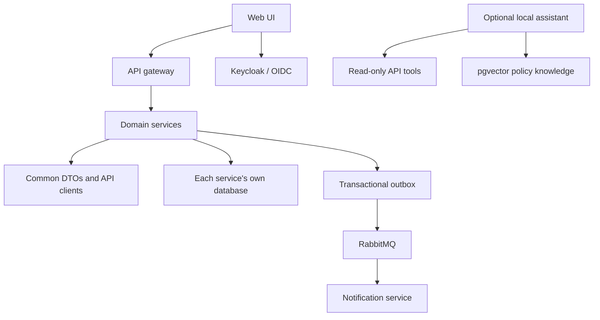

# Repository architecture and ownership

The repository groups a Maven multi-module backend under `backend/` and a dependency-free browser application under `web/`. The root POM remains the parent/reactor; Docker builds use the root context. Folder ownership is summarized in the [repository map](../README.md#repository-map). Maven, Docker, Compose, contracts and deployment tools resolve the same nested service paths.

## Source map

| Location                                         | Owns                                                                                     |
| ------------------------------------------------ | ---------------------------------------------------------------------------------------- |
| `backend/member-service/`                        | Member identity/profile and staff activation                                             |
| `backend/subscription-service/`                  | Subscription periods, recorded payments and eligibility                                  |
| `backend/booking-service/`                       | Courts, availability, bookings, players, waitlists, weekly series and reception audit    |
| `backend/access-service/`                        | Check-in decisions and access history                                                    |
| `backend/notification-service/`                  | Event consumption, deduplication and SMTP retry                                          |
| `backend/assistant-service/`                     | Local retrieval and model orchestration; read-only availability tools                    |
| `backend/api-gateway/`                           | External routing and JWT validation                                                      |
| `backend/config-server/`, `backend/config-repo/` | Configuration service and canonical service configuration                                |
| `backend/discovery-server/`                      | Local service discovery                                                                  |
| `backend/common/`                                | Shared API DTOs, clients, security, idempotency and transactional-outbox infrastructure  |
| `backend/contract-tests/`                        | Consumer verification against producer stubs                                             |
| `web/`                                           | Greek browser UI, isolated demo and web-specific tests                                   |
| `evals/`                                         | Locked datasets, assertions and AI evaluation harness                                    |
| `scripts/`                                       | Stable operator entry points and policy tests; [command catalogue](../scripts/README.md) |
| `scripts/quality/`                               | Repository process execution and publication/structure checks                            |
| `infra/`                                         | Compose support, identity, monitoring, production, cloud and security configuration      |
| `docs/`                                          | Product/runbooks, dated evidence and screenshots; [index](README.md)                     |
| `.github/`                                       | CI, security, release and cloud workflow definitions                                     |
| `.runtime/`, `.tools/`                           | Ignored local output, credentials, backups, downloads and caches                         |

Java follows `src/main/java`, `src/test/java`, `src/it/java` and `src/contract-test/java`. Resources and Flyway migrations belong to the owning module. Small services retain one service package; the larger booking service separates business responsibilities into named services rather than putting every operation into one controller.

## Dependency boundaries

Domain services must not import another service's entities or repositories. Use an explicit HTTP client and API DTO. `common` must not depend on a service implementation. The contract module consumes test-scoped stubs, not another service's persistence. `npm run check` checks declared Java package ownership and cross-service imports; it is a source convention check, not a complete bytecode dependency analysis.

The browser entry point `web/app.js` loads configuration and authentication. `web/ui/application.js` coordinates state, resources and rendering. `dialogs.js` composes profile, booking, membership, game and reception factories from `web/ui/dialogs/`. `events.js` composes action, field and form listeners from `web/ui/events/`. These modules receive their state and operations through explicit factory arguments; pages, assistant UI and view preservation remain separate. Authentication, API transport, resource caching and persisted mutation intents remain independent. Browser code must not import Node/npm/operator/test tooling or form a circular module graph. See [frontend maintenance](FRONTEND.md).

Operator entry points remain in `scripts/`. Support modules and their tests are grouped by ownership: `operations/` for backup and deployment configuration, `security/` for pure scan policy and image identity, `cloud/` for release/rollback policy, `e2e/` for game/reception stack checks, and `quality/` for publication paths, source rules and repository orchestration. [Code map and extension points](CODE-MAP.md).

## Configuration and evidence

Canonical Kubernetes inputs are `backend/config-repo/`, `infra/keycloak/`, `infra/postgres/init.sql` and `web/app-config.json`. `npm run sync:k8s` refreshes their copies in `infra/k8s/config/`; `npm run sync:k8s:check` detects drift. Neither contacts a cluster.

Kubernetes puts `application.yml` and `notification-service.yml`, which bind database/broker/SMTP credentials from environment variables, in the generated `padel-spring-config` Secret. The Config Server projects it with the non-sensitive `padel-config` ConfigMap into the same read-only directory. This is a manifest/source check; the scaffold has not been deployed to a cluster. Kubernetes Secrets still require appropriate RBAC and encryption at rest in a real cluster.

Keycloak projects the public theme assets from `padel-login-theme` together with the Greek message bundle from the `padel-login-messages` Secret. The messages contain public password-field labels, not credentials; storing the bundle separately avoids ambiguous password-like ConfigMap keys without a scanner suppression. The mounted paths remain those expected by the Keycloak theme.

Use `.env.example` for documented local fixtures. Actual environments, key stores, Terraform state/plans/variables and generated bundles stay private. `.gitignore` protects untracked files; the repository check also rejects private/generated paths that have already become tracked. These checks do not replace a secret scan and review of the exact publication list.

Reports under `docs/results/`, `docs/ai-evals/`, `docs/performance/`, `docs/security/` and `docs/cloud/` are historical evidence. Do not rewrite them as current results. Frozen AI data retain their byte hashes. New verification belongs in a dated report with scope and limitations; transient logs and traces remain ignored.

## Invariants during refactoring

- PostgreSQL booking/player exclusion constraints remain the final concurrency guard.
- Idempotency claims, domain changes and outbox events retain their transaction boundaries.
- Role and ownership checks stay in the backend; UI visibility is not authorization.
- Notification delivery remains at least once. A source refactor must not claim exactly-once SMTP.
- AI tools remain read-only and bookings require human confirmation.
- Applied SQL migrations and frozen evaluation inputs are not edited for formatting.
- A container rollback is not a database rollback. Cloud execution remains separate from local mocks.

The [developer guide](../CONTRIBUTING.md) defines commands and review conventions. [Verification history](VERIFICATION.md) distinguishes local checks, real integration experiments and pending external deployment.
