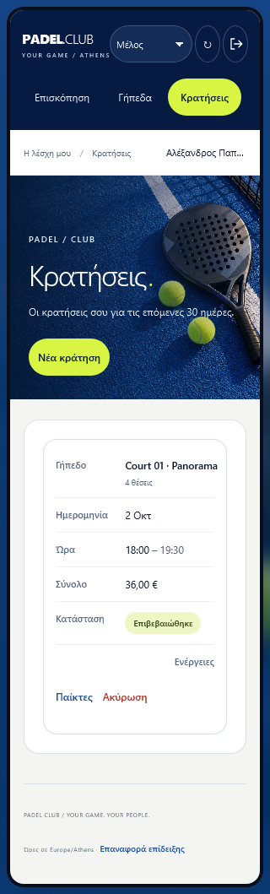
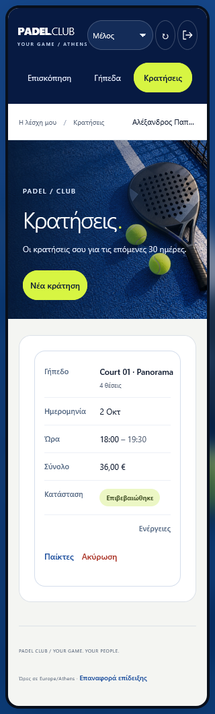

# Browser compatibility and accessibility — 13 October 2026

Later verification: the [25 October final audit](FINAL-AUDIT-2026-10-25.md) passed the expanded **252/252** suite using Playwright **1.64.1** after investigating the recorded 1.63.0 Firefox timeouts. The dated 13 October results below retain their original scope.

The Greek interface polish is installed locally: login/registration and validation messages, notification presentation, Greek email copy, and booking cards below 600px. The new checks exercise that interface in Chromium, Firefox and WebKit.

## Repeatable coverage

The Playwright suite runs 27 scenarios in each of nine projects: three engines at 1280×900, 390×844 and 320×740. Firefox uses narrow viewports and touch support; its `isMobile` emulation is unsupported and is omitted. The suite uses isolated demo data and controlled transport fixtures where documented, rather than writing to the live application database.

The final static run passed **243/243 checks**, with no failures, skips, retries or flaky cases. Each engine passed 81 checks. The repository Node suite passed **97/97**. Initial scans found one low-contrast statistic and an unfocusable subscription scroll region. The first complete run passed 240 checks and failed three refresh tests that assumed mouse clicks focus buttons in every engine; that result is retained privately. The test now activates the button with the keyboard and preserves its original focus assertions.

Three scenarios add accessibility coverage: axe scans with WCAG 2 A/AA, 2.1 A/AA and 2.2 AA tags; keyboard navigation and focus containment/restoration for the profile dialog; and keyboard scrolling of subscription history. Scans cover the public welcome, seven member pages, profile and booking forms, and three staff pages. No axe rules or elements are excluded.



The small denominator in overview statistics now has readable contrast, and the subscription-history scroll region is labeled, focusable and has a visible focus outline. Visual inspection also caught WebKit's native mobile select background obscuring the role text; the control now uses explicit appearance and a contrasting dropdown arrow. Mobile bookings remain labeled cards; player and cancellation actions fit at 320px and 390px.



The real `padel-e2e` walkthrough can also select an engine and scan the actual Greek Keycloak login, registration, validation errors and registration at 390px. It uses public registration, real PKCE sign-in, onboarding, membership activation, booking, waitlist, game participation, cancellation, notifications and re-login. Its synthetic fixtures are cleaned in `finally` and existing domain rows are checked for changes.

All three live walkthroughs passed **17/17 steps** each, with no uncaught browser errors, successful cleanup and existing member/booking/subscription rows unchanged. The **117 static scans and 12 live identity scans** reported zero automated violations. Their incomplete findings are preserved for human review. The [dated result summary](results/frontend/browser-accessibility-2026-10-13.json) includes per-project totals, source hashes, cleanup outcomes and exact limitations.

```powershell
npm --prefix web ci
Set-Location web
npx playwright install chromium firefox webkit
npm run test:browser
Set-Location ..
node scripts/user-journey.mjs --experience --browser firefox --accessibility
node scripts/user-journey.mjs --experience --browser webkit --accessibility
```

Run real walkthroughs serially. They require the dedicated local stack and create temporary test identities; they are not part of the default read-only checks. Engine-specific evidence and fixture journals go into ignored `test-results/ux-walkthrough-<engine>/`. The static browser suite retains HTML, JSON, screenshots, traces and axe attachments under `web/playwright-report/` and `web/test-results/`.

## Scope of the result

Playwright's WebKit build checks engine compatibility on Windows. It does not execute branded Safari on macOS or a physical iPhone. Playwright documents this distinction in its [browser support guide](https://playwright.dev/docs/browsers#webkit).

Automated accessibility scans and keyboard checks are useful regression evidence, not WCAG certification or a complete NVDA/VoiceOver audit. Axe `incomplete` findings require human review and are retained in the raw reports, including contrast over photographic/gradient backgrounds and empty `aria-invalid` attributes in inherited Keycloak templates. See Playwright's [accessibility testing guidance](https://playwright.dev/docs/accessibility-testing).

The GitHub browser job now installs all three engines before executing the same suite. This workflow change is prepared locally; no GitHub run, public deployment or cloud resource is claimed. Earlier dated reports retain their original Chromium-only scope.
