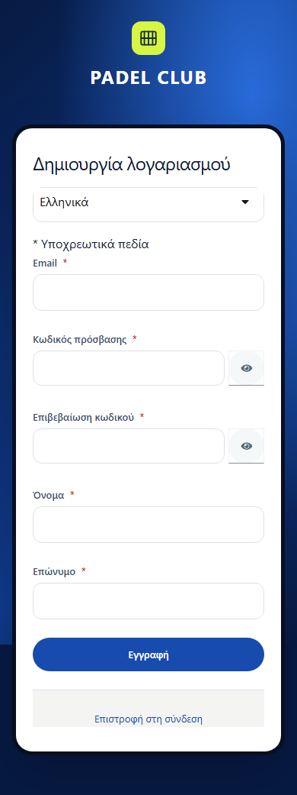
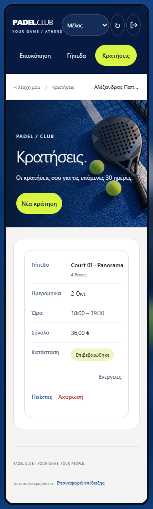

# Greek interface and mobile booking polish — 12–13 October 2026

The local application uses Greek login/registration text, Greek in-app and email notification presentation, and booking cards on small screens. The sports theme and top-left navigation are retained.

The follow-up [browser and accessibility check on 13 October](BROWSER-ACCESSIBILITY.md) extends coverage to Firefox and Windows WebKit, with real Greek identity-form scans and keyboard regressions. The measurements below preserve the original polish run.

## Authentication

The Padel Keycloak theme adds a Greek message bundle covering login, registration, required-field/password errors, logout confirmation and password-reset text. The realm enables Greek and English with Greek as its default; the web sign-in request sends `ui_locales=el`. Authentication templates, PKCE, audience checks and role rules remain unchanged.

The message bundle is included in canonical Kubernetes configuration copies and the theme ConfigMap mount. Existing local realms use `scripts/apply-local-login-theme.mjs --example-env`; fresh imports use the updated realm source. These are local configuration changes, not a Kubernetes deployment.

## Notifications

The web translates the four existing English system notification types and formats timestamps in Greek using Europe/Athens. It handles existing history without rewriting database records. Unknown titles/details are retained and escaped during rendering rather than replaced with invented text.

Email delivery applies equivalent Greek subject/body presentation and a Greek sign-off. The event payload and stored history remain intact; mail retry and deduplication behavior is unchanged. The local SMTP destination is Mailpit.

## Mobile bookings

At widths up to 600px, each booking table row becomes a labeled card showing court/player, date, time, price, status and actions. Headers remain available to assistive technology, and explicit table/row/cell roles preserve the table structure. Only booking tables use this layout; the reception weekly calendar retains its local scroll behavior.

The browser regression checks that all six booking fields and player actions fit at 390px and 320px without horizontal scrolling. The complete suite passed 72 Chromium checks across three viewports; Node tests passed 97 checks including legacy notification translation and preview asset boundaries. These are simulated viewports, not a full screen-reader or physical-device accessibility audit.

See the [dated result summary](results/frontend/interface-polish-2026-10-12.json) for the live journey, functional/email verification, exact scope and source hashes. Earlier [UX findings](UX-WALKTHROUGH.md) retain their original results; their English-text/mobile-table refinements are addressed by this change.
