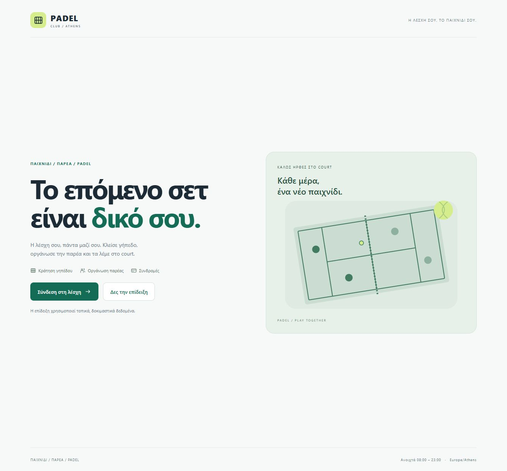
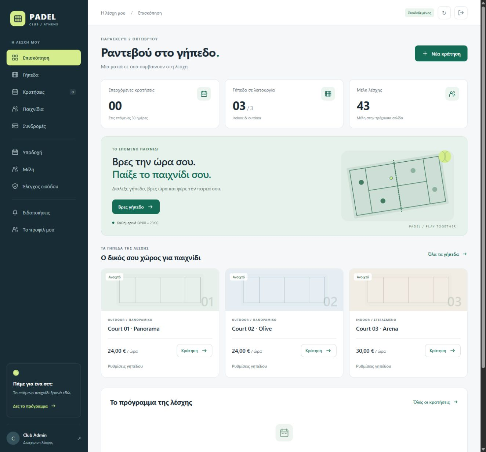
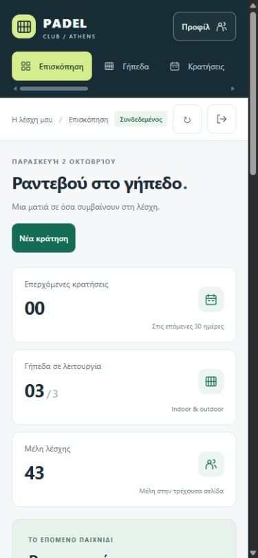
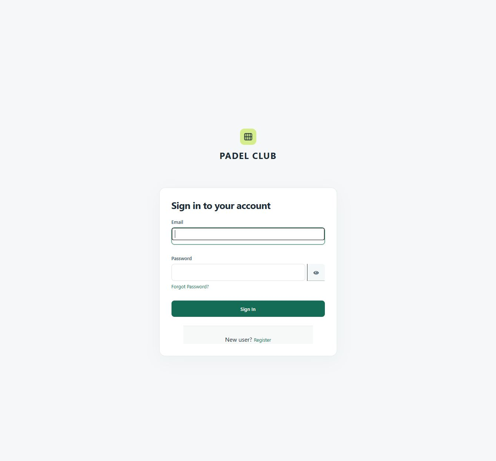
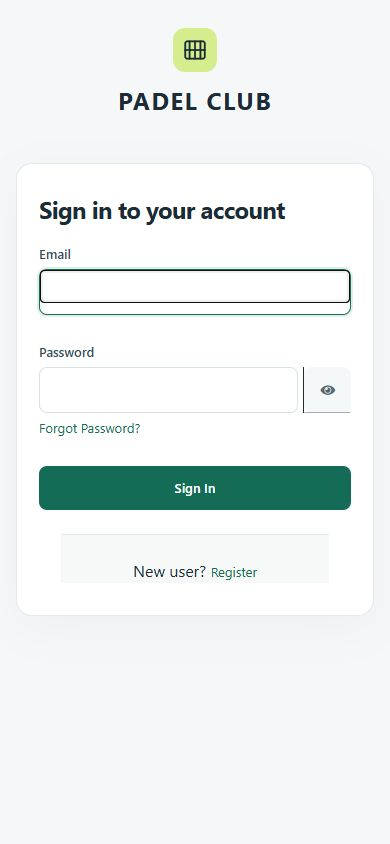

# Συνολική εμφάνιση Padel Club — 2 Οκτωβρίου 2026

Ιστορική τεκμηρίωση της προηγούμενης εμφάνισης. Στις 12 Οκτωβρίου εφαρμόστηκε το [νέο φωτογραφικό sports design](SPORT-DESIGN.md), με πλοήγηση πάνω αριστερά και ενιαία αισθητική σε όλες τις καρτέλες. Οι παρακάτω ημερομηνίες και μετρήσεις αφορούν τον αρχικό σχεδιασμό.

Ο σχεδιασμός βασίζεται σε ουδέτερα backgrounds, σκούρα μπλε πλοήγηση, πράσινες ενέργειες και lime ένδειξη ενεργής ενότητας. Η αρχική έχει καθαρή διάταξη δύο στηλών, άμεση σύνδεση/επίδειξη και διανυσματική απεικόνιση γηπέδου χωρίς εξωτερικά assets ή fonts. Το dashboard εμφανίζει πρώτα τα πραγματικά στοιχεία της λέσχης. Η πλοήγηση διαχωρίζει τις ενότητες παιχνιδιού, διαχείρισης και λογαριασμού.

Κάρτες γηπέδων/συνδρομών/παιχνιδιών, πίνακες, ημερολόγιο υποδοχής, καταστάσεις, ενημερώσεις, κενές οθόνες, φόρμες και όλοι οι διάλογοι έχουν κοινές αποστάσεις, χρώματα και τυπογραφία. Οι πίνακες και το εβδομαδιαίο πρόγραμμα κυλούν τοπικά όταν χρειάζεται. Στο κινητό η πλοήγηση κυλά οριζόντια, το προφίλ παραμένει προσβάσιμο, οι φόρμες γίνονται μία στήλη και οι διάλογοι περιορίζονται στην οθόνη. Διατηρούνται η εστίαση πληκτρολογίου, η ένδειξη σφάλματος/φόρτωσης και η μειωμένη κίνηση.

Το theme `infra/keycloak/themes/padel/login/` επεκτείνει το `keycloak.v2` με CSS και SVG λογότυπο. Τα templates και οι έλεγχοι σύνδεσης παραμένουν του Keycloak, σύμφωνα με τον [επίσημο μηχανισμό θεμάτων](https://www.keycloak.org/ui-customization/themes). Καλύπτει και εγγραφή, ανάκτηση κωδικού και τις υπόλοιπες φόρμες login του γονικού theme. Το αγγλικό κείμενο των φόρμων Keycloak διατηρείται. Το theme συνδέεται read-only στο local Compose, στο νέο production generator και στο Kubernetes ConfigMap.

Για ήδη εισαγμένο τοπικό realm, μετά την ενημέρωση του Keycloak container, χρησιμοποιείται `node scripts/apply-local-login-theme.mjs --example-env` (ή χωρίς flag για `.env`). Το script εφαρμόζει μόνο `loginTheme: padel`, επειδή το realm import παραλείπει τα υπάρχοντα realms. Τα ήδη παραχθέντα production bundles δεν αντικαθίστανται· νέα bundles περιλαμβάνουν το mount. Στο Kubernetes ανανεώνονται τα ConfigMap inputs με `scripts/prepare-k8s.ps1`. Πριν αναβάθμιση Keycloak χρειάζεται επανέλεγχος των CSS selectors του γονικού theme.

## Επαλήθευση

- **37/37 frontend Node tests**, JavaScript syntax και Prettier checks.
- **45/45 Chromium browser tests**, 1280×900, 390×844 και 320×740, χωρίς skipped/flaky/failures. Τελικό report: **02/10/2026 12:00:24 Europe/Athens**, [JSON](results/frontend/frontend-browser-results.json).
- **4/4 production configuration tests** και επιτυχές `nginx -t`.
- Τοπικό render Kubernetes με προσωρινά placeholders, περιλαμβανομένου ConfigMap και theme mount. Δεν έγινε deployment σε cluster ή δημόσιο server.
- Πραγματική OIDC σύνδεση ADMIN στο `localhost:3000`, φόρτωση 3 γηπέδων/43 μελών και άνοιγμα φόρμας κράτησης με πραγματικές ώρες, χωρίς υποβολή κράτησης.
- Οπτικός έλεγχος dashboard και Keycloak σύνδεσης/εγγραφής σε κινητό. Η εγγραφή ελέγχθηκε μόνο ως φόρμα· δεν δημιουργήθηκε νέος λογαριασμός. Τα πεδία κειμένου είχαν 16px και δεν υπήρχε εξωτερική οριζόντια υπερχείλιση.

Τα backend tests δεν επαναλήφθηκαν για την εμφάνιση. Firefox, Safari/WebKit, φυσικές συσκευές και πλήρης πιστοποίηση προσβασιμότητας δεν περιλαμβάνονται στον παρόντα έλεγχο.

## Εικόνες

