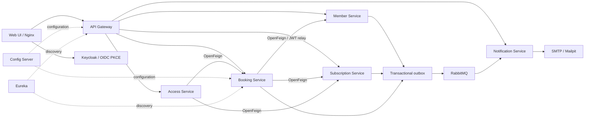

# Padel Club Management System

Εφαρμογή για διαχείριση λέσχης padel, με **Spring microservices backend** και **web περιβάλλον στα ελληνικά** για μέλη, reception και διαχειριστές.

**Τρέχουσα έκδοση — [v1.1.0](RELEASE-v1.1.0.md):** 10 δημόσια container images με επαληθευμένες υπογραφές provenance/SBOM, δοκιμασμένη εγκατάσταση Kubernetes/kind και **μηδενικές ενεργές εξαιρέσεις ασφάλειας**. [Επίσημο release και αποδεικτικά](https://github.com/Stelios-developer/padel-club-management-platform/releases/tag/v1.1.0) · [Συντήρηση και υπόλοιπα ευρήματα](SECURITY-MAINTENANCE.md).

Το project δημιουργήθηκε από την περιγραφή του Swimming Club Management System στην εικόνα αναφοράς. Είναι νέα υλοποίηση για padel· δεν αντιγράφει κώδικα του EAK-Swimming, καθώς το repository δεν ήταν διαθέσιμο κατά την υλοποίηση.

## Τι περιλαμβάνει

- Μέλη: προφίλ συνδεδεμένο με το Keycloak account, αυτοεγγραφή και ενεργοποίηση/απενεργοποίηση από τη reception.
- Συνδρομές: μηνιαία, τριμηνιαία και ετήσια, με καταχώριση πληρωμής από εξουσιοδοτημένο προσωπικό.
- Γήπεδα: δύο outdoor και ένα indoor, τιμοκατάλογος και προσωρινή παύση κρατήσεων.
- Κρατήσεις: 60/90/120 λεπτά, 2–4 παίκτες, έλεγχος ενεργής συνδρομής και αποτροπή διπλοκράτησης.
- Παιχνίδια: ονομαστικοί παίκτες, προσκλήσεις με αποδοχή/απόρριψη, ανοιχτά παιχνίδια με φίλτρο επιπέδου και προσωπικό ημερολόγιο συμμετοχών.
- Αναμονή για κατειλημμένη ώρα με ειδοποίηση στην εφαρμογή, χωρίς αυτόματη κράτηση. Εβδομαδιαίες σειρές 2–4 παιχνιδιών με κοινή τοπική ώρα και αποθήκευση όλων ή καμίας κράτησης. [Οδηγίες και όρια](PADEL-PLAY.md).
- Η PostgreSQL απαγορεύει επικαλυπτόμενες CONFIRMED κρατήσεις στο ίδιο γήπεδο και ACCEPTED συμμετοχές του ίδιου παίκτη, ακόμη και σε απευθείας INSERT/UPDATE. Διαδοχικές ώρες και διαφορετικοί παίκτες σε διαφορετικά γήπεδα επιτρέπονται. [Περιορισμός γηπέδων](BOOKING-CONSTRAINT.md) και [συμμετοχών](PADEL-PLAY.md).
- Προστασία διπλής καταχώρισης συνδρομών/κρατήσεων: ίδιο αίτημα και κλειδί επιστρέφουν την αρχική εγγραφή, ακόμη και μετά από restart. Οι φόρμες διατηρούν το εκκρεμές κλειδί σε ανανέωση σελίδας. Το [API contract](API.md#idempotency-contract) περιγράφει τη χρήση για άλλους clients.
- Έλεγχος εισόδου: έγκυρη κράτηση, ενεργό μέλος, ενεργή συνδρομή και κατάλληλη ώρα προσέλευσης, με ιστορικό ελέγχων.
- Υποδοχή: εβδομαδιαίο ημερολόγιο ανά γήπεδο, αναζήτηση μελών με όνομα/email/τηλέφωνο, ατομική μεταφορά κράτησης, παρουσίες ανά επιβεβαιωμένο παίκτη και ιστορικό αλλαγών με υπάλληλο, χρόνο και πριν/μετά. [Οδηγίες υποδοχής](RECEPTION.md).
- Ειδοποιήσεις: welcome, ενεργοποίηση/ακύρωση συνδρομής και επιβεβαίωση/ακύρωση κράτησης, μέσω RabbitMQ και email.
- Modern και clean responsive web UI: dashboard, διαθεσιμότητα ωρών, κρατήσεις, συνδρομές, μέλη, reception και ενημερώσεις, με κοινή εμφάνιση για κάρτες, πίνακες, φόρμες και διαλόγους.
- Τοπική **λειτουργία επίδειξης**, με σαφή ένδειξη και δοκιμαστικά δεδομένα. Δεν επικοινωνεί με το backend και δεν στέλνει email.

Η καταχώριση συνδρομής καταγράφει πληρωμή που έχει ήδη γίνει στη reception. Η συνδρομή επιτρέπει κράτηση· η χρέωση γηπέδου είναι ξεχωριστή. Δεν υπάρχει σύνδεση με τράπεζα ή υπηρεσία online πληρωμών.

## Ασφάλεια και supply chain

Το τοπικό μέρος του [σταδίου 6 — ασφάλεια και supply chain](SUPPLY-CHAIN.md) περιλαμβάνει Trivy gates, Syft/CycloneDX SBOM για 10 application images, pinned Actions/Docker bases και επαλήθευση ότι εγκαταστάθηκε το image που σαρώθηκε. Διορθώθηκαν runtime εξαρτήσεις και το νέο πλήρες backend verify πέρασε **135 tests**. Η αρχική καταγραφή περιλάμβανε πέντε εξαιρέσεις· διατηρείται ως ιστορικό snapshot. Η [τρέχουσα πολιτική](SECURITY-HARDENING.md) δεν περιλαμβάνει εξαιρέσεις. [Πραγματικά αποτελέσματα και όρια](security/results.json).

Τα GitHub Actions και CodeQL έχουν εκτελεστεί στο δημόσιο repository. Το [v1.1.0 release](RELEASE-v1.1.0.md) δημοσίευσε 10 images με 40 ανεξάρτητους κρυπτογραφικούς ελέγχους provenance/SBOM. Το CI του release tag πέρασε 21/21 jobs, με 154 backend, 252 browser, 60 Compose E2E/recovery και 61 Kubernetes cases· πέρασε και ο ξεχωριστός έλεγχος υποδομής. Η αντιστοίχιση image-source και release-tag commit καταγράφεται στα αποδεικτικά. Το [v1.0.0](RELEASE-v1.0.0.md) διατηρείται ως ιστορικό. Το πραγματικό release και η τοπική λειτουργία δεν αποτελούν πιστοποίηση production readiness.

Προστέθηκε η [τοπική προετοιμασία AWS/Terraform](CLOUD.md): encrypted state/data, retained EBS, περιορισμένοι GitHub OIDC ρόλοι, deployment με signed image digests και έλεγχοι rollback. Η προετοιμασία ελέγχεται με mock AWS provider· δεν δημιουργήθηκαν AWS πόροι ή χρεώσεις. Η τρέχουσα [πολιτική εξαιρέσεων](../infra/security/exceptions.json) δεν περιλαμβάνει πλέον εξαιρέσεις: διορθώθηκαν τα read-only filesystems των τριών Kubernetes υπηρεσιών και η unrestricted HTTPS έξοδος του AWS template. [Αποδείξεις και όρια](SECURITY-HARDENING.md). [Πραγματικά αποτελέσματα και εκκρεμότητες](cloud/results.json).

## Γρήγορη προβολή χωρίς Docker

Απαιτείται Node.js 24+, σύμφωνα με το workspace toolchain. Η εφαρμογή δεν έχει runtime npm dependencies. Για browser tests χρειάζεται `npm --prefix web ci`.

```powershell
node web/server.cjs
```

Άνοιξε **http://localhost:3000** και επίλεξε **«Δες την επίδειξη»**. Από το επάνω μενού μπορείς να αλλάξεις μεταξύ μέλους και διαχειριστή. Τα δοκιμαστικά δεδομένα αποθηκεύονται στο localStorage του browser και επανέρχονται με το «Επαναφορά επίδειξης».

Η επιλογή «Σύνδεση στη λέσχη» χρησιμοποιεί το πραγματικό Keycloak και απαιτεί το πλήρες stack. Μετά από ανανέωση της σελίδας απαιτείται νέα είσοδος στην εφαρμογή· τα access/refresh tokens διατηρούνται μόνο στη μνήμη, ενώ η συνεδρία Keycloak μπορεί να παραμένει ενεργή.

## Εκκίνηση του πλήρους stack

Απαιτείται Docker Desktop με Linux containers. Προτεινόμενη διαθέσιμη μνήμη: 8 GB ή περισσότερο. Σταμάτησε πρώτα το standalone web server αν χρησιμοποιεί ήδη την πόρτα 3000.

```powershell
Copy-Item .env.example .env
docker compose up -d --build
docker compose ps
```

Η πρώτη εκκίνηση κάνει download dependencies/images και χρειάζεται χρόνο. Οι υπηρεσίες εμφανίζονται μέσω Eureka· αν η είσοδος ολοκληρωθεί πριν από την εγγραφή τους, περίμενε λίγο και επίλεξε «Ανανέωση».

| Εργαλείο                          | Διεύθυνση              |
| --------------------------------- | ---------------------- |
| Εφαρμογή                          | http://localhost:3000  |
| API Gateway                       | http://localhost:8080  |
| Keycloak                          | http://localhost:8081  |
| Eureka                            | http://localhost:8761  |
| RabbitMQ management               | http://localhost:15672 |
| Mailpit — δοκιμαστικά email       | http://localhost:8025  |
| Grafana, με observability profile | http://localhost:3001  |

Οι δημοσιευμένες θύρες συνδέονται μόνο στο loopback. PostgreSQL, RabbitMQ AMQP, Config Server και domain services δεν δημοσιεύουν θύρες στο host.

### Λογαριασμοί τοπικής ανάπτυξης

Το realm import περιλαμβάνει τους παρακάτω **δοκιμαστικούς** χρήστες:

| Χρήστης                 | Κωδικός           | Ρόλος          |
| ----------------------- | ----------------- | -------------- |
| `member@padel.local`    | `PadelMember123!` | MEMBER         |
| `clubadmin@padel.local` | `PadelAdmin123!`  | ADMIN + MEMBER |

Ο administrator της κονσόλας Keycloak είναι ξεχωριστός: username/password από το `.env`. Η κονσόλα Grafana χρησιμοποιεί `admin` και το `GRAFANA_PASSWORD` του `.env`.

Πρώτη πραγματική ροή:

1. Συνδέσου ως `member` και συμπλήρωσε το προφίλ σου.
2. Αποσυνδέσου και μπες ως `clubadmin`. Συμπλήρωσε και το δικό του προφίλ.
3. Στα «Μέλη», άνοιξε τις συνδρομές του μέλους και κατέγραψε πληρωμένη συνδρομή με ημερομηνία έναρξης σήμερα.
4. Μπες ξανά ως μέλος και κάνε κράτηση σε διαθέσιμη ώρα.
5. Δες το email στο Mailpit και την ειδοποίηση στην εφαρμογή.
6. Ως διαχειριστής, επίλεξε την κράτηση στον «Έλεγχο εισόδου». Η είσοδος επιτρέπεται από 15 λεπτά πριν την έναρξη έως, αποκλειστικά, τη λήξη της.

Οι νέες εγγραφές γίνονται από τη φόρμα Keycloak. Μέλος στη βάση του club δημιουργείται όταν ο χρήστης συμπληρώσει το προφίλ του. Δεν χρειάζεται χειροκίνητη αντιγραφή UUID.

## Αρχιτεκτονική



Java 21, Spring Boot **4.0.8**, Spring Cloud **2025.1.3**, Maven, PostgreSQL, Flyway, RabbitMQ, Keycloak, Docker, Kubernetes, GitHub Actions, Prometheus, Grafana, Loki, Tempo και OpenTelemetry.

Η ποιότητα του backend ενισχύθηκε με **Testcontainers 2.0.5 και Spring Cloud Contract 5.0.3**: 17 δοκιμές πραγματικής PostgreSQL/RabbitMQ και 18 producer/consumer contract tests, μαζί με το νέο CI job. [Εκτέλεση και αποτελέσματα](BACKEND-QUALITY.md). Προστέθηκε προαιρετικός [βοηθός λέσχης με Spring AI 2.0.1, Ollama και pgvector](AI-ASSISTANT.md): τεκμηριωμένοι κανόνες με παραπομπές, πραγματικές διαθέσιμες ώρες/τιμές μέσω GET tools και άνοιγμα της φόρμας για ανθρώπινη επιβεβαίωση. Λειτουργεί τοπικά χωρίς cloud API key και έχει ξεχωριστά reports πραγματικού μοντέλου και browser δοκιμών.

Το [promptfoo evaluation package](AI-EVALUATION.md) περιλαμβάνει 100 κλειδωμένες περιπτώσεις, JSON Schema, ελέγχους δικαιωμάτων/παραπομπών/πραγματικών slots και quality gates ανά κατηγορία. Η διατηρημένη v4 / qwen3:0.6b πέτυχε 34/40 development και 52/60 evaluation regression, χωρίς κρίσιμες αποτυχίες αλλά με αποτυχημένα gates ποιότητας. Η χειρότερη v5 αποσύρθηκε. [Αποτελέσματα και όρια](ai-evals/SUMMARY.md). Η υποδομή αξιολόγησης λειτουργεί· η ποιότητα του μοντέλου χρειάζεται ακόμη βελτίωση πριν από κανονική χρήση.

Προστέθηκαν [Resilience4j circuits/bulkheads και Toxiproxy fault tests](BACKEND-RESILIENCE.md), με JWT relay στο request thread, bounded downstream αναμονή και απόρριψη κράτησης όταν δεν επαληθεύεται η συνδρομή. Το πλήρες backend build πέρασε **133 tests**, περιλαμβανομένων 9 νέων σεναρίων βλάβης/ανάκαμψης. [Μετρήσεις και όρια](results/backend/backend-resilience-results.json). Υπάρχουν circuit/capacity alerts, Grafana panels και runbook· η επίτευξη production SLO και η ποιότητα AI δεν πιστοποιούνται από αυτές τις δοκιμές.

Προστέθηκε [απομονωμένο k6/JFR/PostgreSQL benchmark](PERFORMANCE.md). Με 60.400 συνθετικές κρατήσεις, το availability query επιστρέφει 10 intervals αντί για 20.400 πλήρη entities, χρησιμοποιώντας το υπάρχον GiST index. Η διάμεσος τριών run p95 μειώθηκε **129,38 → 14,67 ms** στο ίδιο τοπικό φορτίο/limits, με 6/6 correctness runs και πλήρες backend verify **135 tests**. [Αναλυτικά αποτελέσματα και όρια](performance/results.json). Η μέτρηση αφορά direct domain HTTP και δεν δηλώνει maximum capacity ή production SLO.

Χρησιμοποιείται συμβατό ζεύγος Boot/Cloud σύμφωνα με την [επίσημη τεκμηρίωση Spring Cloud](https://spring.io/projects/spring-cloud/). Το Boot 4 χρησιμοποιεί Jackson 3 και τα νεότερα starters, όπως περιγράφονται στον [οδηγό μετάβασης](https://github.com/spring-projects/spring-boot/wiki/Spring-Boot-4.0-Migration-Guide).

Κάθε domain service έχει ξεχωριστή βάση και migrations. Το κοινό module περιέχει DTOs, security, Feign clients και transactional outbox. Το τοπικό stack χρησιμοποιεί έναν PostgreSQL server και κοινό development database user.

Η αποτροπή διπλοκράτησης συνδυάζει pessimistic court lock και PostgreSQL exclusion constraint. Κάθε παιχνίδι έχει έναν διοργανωτή και ονομαστικούς συμμετέχοντες. Οι αλλαγές παικτών κλειδώνουν την κράτηση για να προστατεύουν τη χωρητικότητα· ξεχωριστό exclusion constraint απαγορεύει επικαλυπτόμενες ACCEPTED συμμετοχές του ίδιου ατόμου σε διαφορετικά γήπεδα.

Τα business events αποθηκεύονται στην ίδια συναλλαγή με τα domain δεδομένα και δημοσιεύονται με RabbitMQ publisher confirms. Η παράδοση είναι **at least once**. Το notification service απορρίπτει διπλά event IDs και έχει persisted retry για SMTP. Το SMTP δεν εγγυάται exactly-once email: σε crash μετά την αποστολή και πριν από το commit μπορεί να επαναληφθεί το email. Malformed events, μετά από retries, οδηγούνται στο `padel.notifications.dead`.

JWT issuer, signature, expiry και audience `padel-api` ελέγχονται στον Gateway και στις υπηρεσίες. Οι υπηρεσίες ελέγχουν επίσης ρόλο και ownership. Η απόκρυψη admin επιλογών στο UI δεν χρησιμοποιείται ως μηχανισμός ασφάλειας.

## Κανόνες κρατήσεων

- Ζώνη ώρας λέσχης: **Europe/Athens**, με χειμερινή/θερινή ώρα.
- Καθημερινά 08:00–23:00, σε βήματα των 30 λεπτών.
- Έως 30 ημέρες από τώρα, με διάρκεια 60/90/120 λεπτών.
- Ενεργή συνδρομή την ημερομηνία του παιχνιδιού και ενεργό προφίλ.
- Ακύρωση από μέλος έως 2 ώρες πριν. ADMIN/STAFF μπορούν να ακυρώσουν και αργότερα.
- Απενεργοποίηση γηπέδου ή συνδρομής δεν ακυρώνει αυτόματα υπάρχουσες κρατήσεις· η reception τις ακυρώνει ξεχωριστά. Ο έλεγχος εισόδου επανελέγχει ενεργό μέλος και συνδρομή.

## Monitoring

Στο `.env`, βάλε `OTEL_TRACES_EXPORTER=otlp` και ξεκίνησε:

```powershell
docker compose --profile observability up -d --build
```

Το Grafana έχει έτοιμα data sources Prometheus/Loki/Tempo και dashboard «Padel Club · Services». Τα metrics εκτίθενται εσωτερικά από το Actuator, τα logs συλλέγονται μέσω Grafana Alloy και τα traces στέλνονται στον Tempo με τον OpenTelemetry Java agent. Για απλή εκκίνηση κράτησε `OTEL_TRACES_EXPORTER=none`.

## Build και tests

Το web χωρίστηκε σε ενότητες και βελτιώθηκε για κινητό, με εμφανές προφίλ, φόρμες μίας στήλης και μεγαλύτερα κουμπιά αφής. Οι [οδηγίες συντήρησης και δοκιμών browser](FRONTEND.md) περιγράφουν τις 45 δοκιμές Chromium σε desktop/390px/320px και το νέο CI job.

Το web συνεχίζει να εμφανίζει τα διαθέσιμα στοιχεία όταν μία υπηρεσία αποτυγχάνει, με τοπικά μηνύματα, στοχευμένο retry και σαφή σήμανση παλιότερων δεδομένων. Δες τη [συμπεριφορά και τους πραγματικούς ελέγχους διακοπών](FRONTEND-RESILIENCE.md).

Οι πραγματικοί έλεγχοι Keycloak/PostgreSQL/RabbitMQ/SMTP εκτελούνται με `.\scripts\e2e.ps1`. Δες τις [οδηγίες E2E](E2E.md) για το ξεχωριστό δοκιμαστικό stack, τις δοκιμές προσωρινών διακοπών και τα αποτελέσματα.

Με Java 21+ και Maven 3.9+:

```powershell
mvn -B verify
npm --prefix web run check
npm --prefix web test
docker compose --env-file .env.example config --quiet
```

Αν το Maven δεν είναι εγκατεστημένο, υπάρχει τοπικός helper για Windows:

```powershell
.\scripts\maven.ps1 -B verify
```

Ο helper κατεβάζει Maven στο `.tools` και χρησιμοποιεί το Java που βρίσκεται στο PATH. Δεν αλλάζει τις ρυθμίσεις Java του συστήματος. Τα tests χρησιμοποιούν H2 και mock εξωτερικές υπηρεσίες. Περιλαμβάνουν concurrent κρατήσεις, ακυρώσεις, όρια συνδρομών, ownership/roles, υπογραφή/issuer/audience/expiry JWT, πρόσβαση και retry/deduplication email. Δεν αντικαθιστούν δοκιμή ολοκλήρωσης με PostgreSQL, RabbitMQ και Keycloak.

Τα GitHub Actions κάνουν build/tests, έλεγχο Compose και build των Docker images. Το ξεχωριστό workflow «Publish container images» εκκινείται χειροκίνητα, επαναλαμβάνει τα tests και δημοσιεύει images στο GHCR με το tag που επιλέγεις. Δεν γίνεται publish ή deploy με απλό push. Το [v1.0.0](RELEASE-v1.0.0.md) είναι το πρώτο επαληθευμένο release με 10 δημοσιευμένα images.

## Kubernetes — τοπικό development

Το [kind profile](KUBERNETES.md) εκτελεί πραγματικό Kubernetes 1.37.0 με 9 signed application images και PostgreSQL, RabbitMQ, Keycloak και Mailpit: συνολικά 13 workloads. Η τοπική επαλήθευση της 26/10/2026 πέρασε **61/61** σενάρια, με επανεκκίνηση PostgreSQL, διατήρηση PVC/δεδομένων και ανάκαμψη HTTP/Keycloak. [Αποτελέσματα](results/backend/kubernetes-kind-2026-10-26.json).

Απαιτούνται Node.js 24+, Docker με Linux containers και περίπου 8 GiB RAM για Docker. Σε μικρό υπολογιστή σταμάτησε πρώτα τα δικά σου Padel Compose/AI stacks. Δεν επηρεάζονται αυτόματα άλλα projects.

```sh
node scripts/kubernetes.mjs up
node scripts/kubernetes.mjs status
node scripts/kubernetes.mjs test
node scripts/kubernetes.mjs report
```

Η εφαρμογή ανοίγει στο **http://localhost:13000**, το Keycloak στο **http://localhost:18081** και το Mailpit στο **http://localhost:18025**. Τα tools εγκαθίστανται ιδιωτικά στο `.tools/kubernetes/` με checksum verification. Το workspace kubeconfig και τα τυχαία infrastructure secrets παραμένουν στο αγνοημένο `.runtime/`. Δεν αλλάζει το καθολικό kubeconfig.

Τα StatefulSets χρησιμοποιούν PVCs, οι υπηρεσίες έχουν probes/resource limits και οι εντολές ελέγχουν την ιδιοκτησία cluster/namespace. Η επανάληψη του setup διατηρεί τους κωδικούς και τα δεδομένα. Το προαιρετικό AI και το Compose monitoring δεν περιλαμβάνονται σε αυτό το profile. Πρόκειται για τοπικό single-node development· η διαγραφή του cluster καταστρέφει την τοπική υποδομή, και δεν υποκαθιστά backup ή production εγκατάσταση.

## Όρια και επόμενες επεκτάσεις

Υπάρχει ξεχωριστό [πακέτο κανονικής εγκατάστασης](PRODUCTION.md) με τυχαία secret files, έξι DB accounts, HTTPS, υποχρεωτικό MFA προσωπικού, κρυπτογραφημένα backups/restore και alerts email/events. Το development stack παραμένει για τοπική χρήση. Η δημόσια εγκατάσταση χρειάζεται ακόμη πραγματικό domain/server, DNS και SMTP credentials. Το realm import εφαρμόζεται στην πρώτη δημιουργία· αλλαγές στο JSON δεν αντικαθιστούν αυτόματα ένα υπάρχον realm.

Υπάρχουν προσκλήσεις και εύρεση συμπαικτών μέσω ανοιχτών παιχνιδιών με φίλτρο επιπέδου. Δεν έχουν προστεθεί αυτόματες προτάσεις βάσει βαθμολογίας, τουρνουά, προπονητές ή online πληρωμές. Ο έλεγχος εισόδου αφορά τον διοργανωτή· η νέα υποδοχή καταγράφει ξεχωριστές παρουσίες ανά επιβεβαιωμένο συμμετέχοντα.

Περιγραφή endpoints και παραδείγματα: [docs/API.md](API.md). Αποτελέσματα ελέγχων της αρχικής υλοποίησης: [docs/VERIFICATION.md](VERIFICATION.md).
