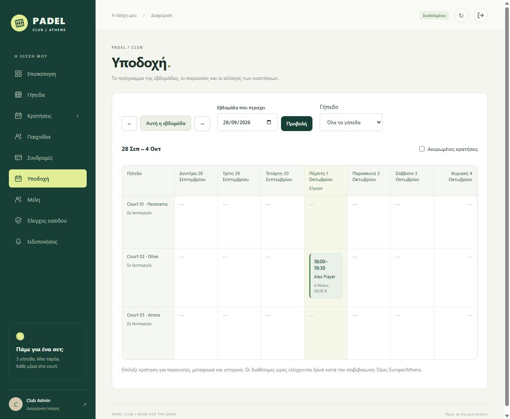

# Εργαλεία υποδοχής

Η νέα ενότητα **Υποδοχή** διατίθεται μόνο σε ADMIN/STAFF και δεν απαιτεί προσωπικό προφίλ μέλους για τον υπάλληλο.

## Ημερολόγιο και αναζήτηση

Το εβδομαδιαίο ημερολόγιο εμφανίζει Δευτέρα–Κυριακή, ανά γήπεδο, σε Europe/Athens. Υπάρχουν επιλογή ημερομηνίας, προηγούμενη/επόμενη/τρέχουσα εβδομάδα, φίλτρο γηπέδου και προαιρετική εμφάνιση ακυρωμένων εγγραφών. Επίλεξε κράτηση για παρουσίες, μεταφορά και ιστορικό. Η ίδια πρόσβαση υπάρχει στη λίστα Κρατήσεις. Οι εβδομάδες μπορούν να είναι και στο παρελθόν.

Στα **Μέλη**, αναζήτησε με μέρος ονόματος, email ή τηλεφώνου. Η αναζήτηση είναι κυριολεκτική, περιλαμβάνει ανενεργά μέλη και έχει 100 αποτελέσματα ανά σελίδα. Το «Όλα τα μέλη» αφαιρεί το φίλτρο. Ο κατάλογος παικτών για απλά μέλη εξακολουθεί να εμφανίζει μόνο ενεργά ονόματα/IDs, χωρίς στοιχεία επικοινωνίας.

## Μεταφορά κράτησης

Η μεταφορά ορίζει νέο γήπεδο/ημερομηνία/ώρα και αιτιολογία 3–240 χαρακτήρων. Διατηρεί διάρκεια, κωδικό, ονομαστικούς παίκτες, προσκλήσεις, ορατότητα και σειρά. Η νέα χρέωση υπολογίζεται από την τρέχουσα τιμή του γηπέδου και εμφανίζεται πριν την επιβεβαίωση. Κάθε παιχνίδι μιας σειράς μεταφέρεται ξεχωριστά.

Μεταφέρονται μόνο μελλοντικές CONFIRMED κρατήσεις χωρίς παρουσίες. Η νέα ώρα είναι εντός 30 ημερών, ανά μισάωρο, 08:00–23:00. Ελέγχονται συγκρούσεις γηπέδου και όλων των ACCEPTED παικτών, ενεργά προφίλ και συνδρομές στη νέα ημερομηνία. PENDING προσκλήσεις διατηρούνται· η επιλεξιμότητά τους ελέγχεται στην αποδοχή.

Τα αρχικά court/start/end προστατεύουν από παλιότερη φόρμα: αλλαγή που προηγήθηκε επιστρέφει 409. Το UUID `Idempotency-Key` διατηρεί μία μεταφορά και μία ειδοποίηση ανά παίκτη στις επαναλήψεις. Οι κλειδαριές των γηπέδων λαμβάνονται σε κοινή σειρά, ενώ τα PostgreSQL exclusion constraints παραμένουν ενεργά.

Κράτηση, πρόγραμμα παικτών, ιστορικό, outbox και αναμονή αλλάζουν στην ίδια συναλλαγή. Αποτυχία διατηρεί την αρχική κράτηση. ACCEPTED/PENDING παίκτες ειδοποιούνται στην εφαρμογή. Η αναμονή του παλιού γηπέδου ειδοποιείται αν ελευθερωθεί όλο το διάστημά της, χωρίς αυτόματη κράτηση.

## Παρουσίες και ιστορικό

Η υποδοχή καταγράφει **Παρών/Απών** ανά ACCEPTED παίκτη, από 15 λεπτά πριν την έναρξη έως, αποκλειστικά, 24 ώρες μετά τη λήξη. Το «Παρών» απαιτεί ενεργό προφίλ και συνδρομή στη μέρα του παιχνιδιού. Το «Απών» επιτρέπει no-show. Η ίδια κατάσταση δεν παράγει δεύτερο ιστορικό· διόρθωση διατηρεί την προηγούμενη τιμή, τον υπάλληλο, την ώρα και την αιτιολογία. Ακύρωση διατηρεί υπάρχουσες παρουσίες και κλείνει την καταγραφή.

Οι παρουσίες είναι ξεχωριστές από τον έλεγχο δικαιώματος εισόδου. Ο υπάρχων έλεγχος εισόδου εξακολουθεί να αφορά τον διοργανωτή και να κλείνει στη λήξη της κράτησης.

Το V7 προσθέτει `booking_changes` και `booking_attendance`. Το ιστορικό καταγράφει δημιουργία/ακύρωση/μεταφορά, ορατότητα/επίπεδο, προσκλήσεις/απαντήσεις/συμμετοχές, σύνδεση σειράς και παρουσίες/διορθώσεις, με subject/όνομα χρήστη, χρόνο και δεδομένα πριν/μετά. Είναι μόνο ανάγνωσης στο API, με 100 εγγραφές ανά σελίδα.

Η καταγραφή ξεκινά με την αναβάθμιση. Δεν ανακατασκευάζεται παλιό ιστορικό και δεν καλύπτονται απευθείας SQL συντηρήσεις, προφίλ/συνδρομές ή ρυθμίσεις γηπέδου. Δεν αποτελεί κρυπτογραφικά αμετάβλητο log απέναντι σε database administrators. Οι online πληρωμές/επιστροφές ήταν μεταγενέστερη επέκταση της αρχικής πρότασης· η χρέωση συνεχίζει να είναι πληρωτέα στη reception.

## Έλεγχοι

Προστέθηκαν δέκα Java έλεγχοι υποδοχής και ένας αναζήτησης μελών, έξι web tests και δέκα σενάρια πραγματικών υπηρεσιών στο `scripts/e2e/reception.mjs`. Καλύπτονται δικαιώματα, μεταφορά/rollback, επιλεξιμότητα/συγκρούσεις παικτών, stale edits, αναμονή, παρουσίες/διορθώσεις, αλλαγή θερινής ώρας, escaping και persistence μετά από restart. Οκτώ παράλληλα retries μεταφοράς και οκτώ παράλληλες παρουσίες ελέγχουν την αποφυγή διπλών αλλαγών. Τα fixtures ανήκουν στο συγκεκριμένο run του `padel-e2e` και ακυρώνονται στο τέλος.

Τα τελικά αποτελέσματα βρίσκονται στο [VERIFICATION.md](VERIFICATION.md).

