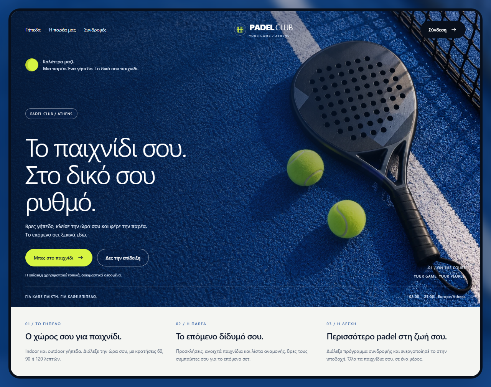
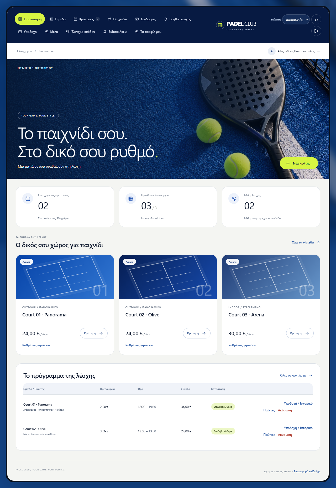
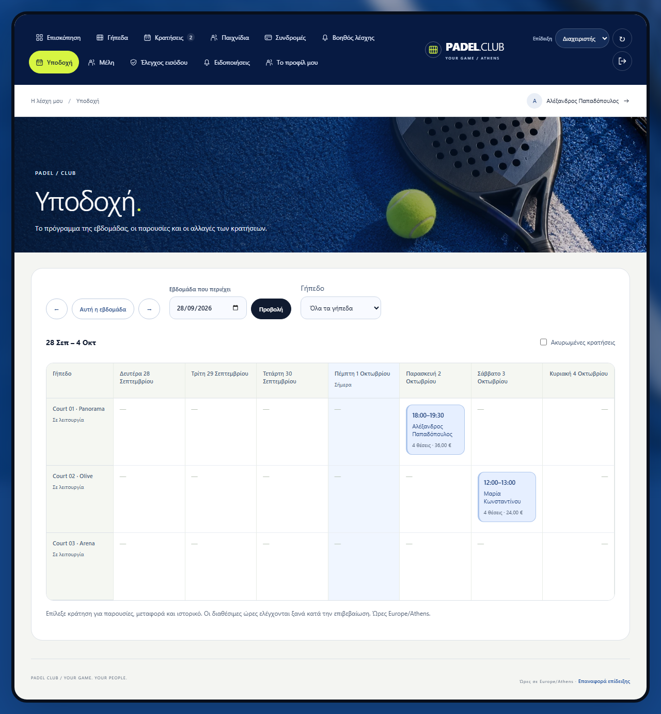
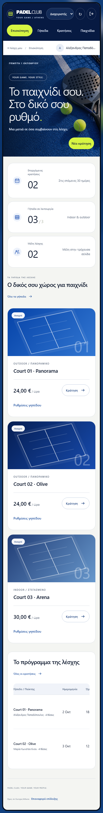
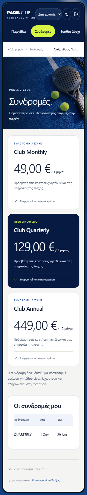
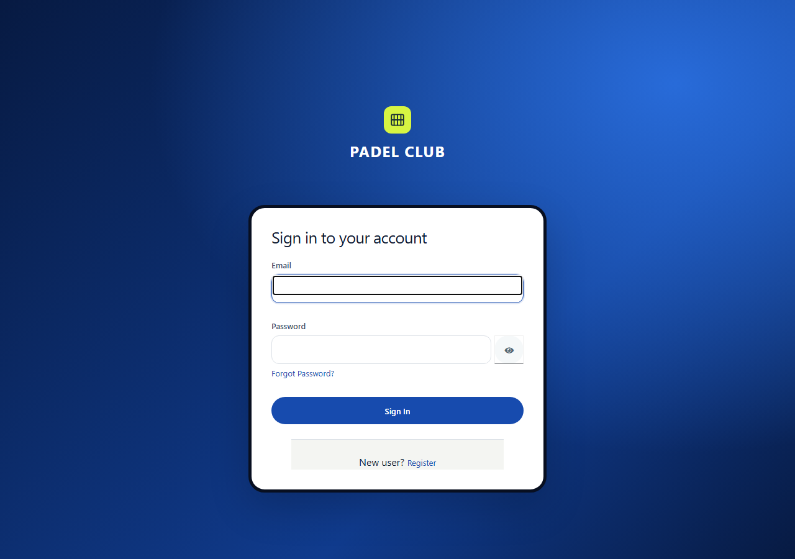
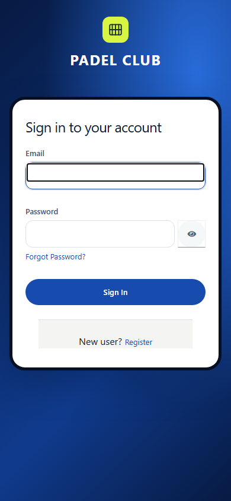

# Padel Club sports design — 12 October 2026

The visual direction follows the user-selected [Padel Sport Website by Design Gamblers](https://dribbble.com/shots/26630436-Padel-Sport-Website): cobalt court photography, large light typography, dark rounded framing, white content cards and lime accents. This application uses an original generated photograph and its own Greek copy. The reference artwork is not bundled in the repository.

## Interface

Navigation is in the upper-left area of the shared header. Desktop tabs wrap when necessary; on narrow screens they scroll horizontally below the brand and session controls. The current tab has a lime pill and `aria-current="page"`. Reception, member management and access validation remain visible only to the appropriate roles.

The shared design covers the welcome page, overview, courts, bookings, games, subscriptions, assistant, reception, members, entry checks, notifications and profile dialogs. Every club page uses the same photographic heading, typography, card treatment and form controls. The welcome page introduces courts, community and subscriptions, with working sign-in and synthetic-demo actions. Copy continues to distinguish reception-recorded payments from online payment processing.

The Keycloak login and registration forms use the same blue, white, dark-border and lime palette. Their background is a local CSS gradient. The existing `keycloak.v2` authentication templates and OIDC/PKCE flow are retained. The canonical theme stylesheet is projected into `infra/k8s/config/` through `scripts/sync-k8s-config.mjs`.

Touch targets, keyboard focus, horizontal table scrolling, mobile text inputs and reduced-motion support are retained. No external font, image CDN, runtime framework or paid service was added.

## Files and image provenance

- `web/clean.css`: shared visual tokens, page backgrounds, responsive layouts and component styling.
- `web/ui/pages.js`: top navigation, welcome page and revised headings.
- `web/ui/application.js`: shared header, session controls and member profile access.
- `web/ui/components.js`: Padel Club wordmark.
- [Original generated photograph, optimized for delivery](../web/assets/padel-court-blue.webp): 1536×1024, **648,010 bytes**. The original PNG was 3,827,452 bytes; WebP delivery reduces the size by about 83%.
- `web/server.cjs`, `web/Dockerfile`, `web/.dockerignore`: explicit public image delivery in both the preview and Nginx image.
- `web/browser-tests/sport-design.spec.js`: photo loading, top navigation and screenshots across all club tabs and the profile dialog.

Image generation mode: **generate**, using the built-in image generator. The user-supplied reference guided the layout; it was not supplied as an image-edit input. The generated image was converted to WebP at quality 87, without changing its composition.

<details>
<summary>Generation prompt</summary>

```text
Use case: photorealistic-natural. Asset type: wide background photograph for a premium padel club web application. Generate an original high-end editorial sports photograph, 1536x1024 landscape composition. Close overhead view of vivid cobalt blue padel court artificial turf, with a matte black and graphite perforated padel racket lying diagonally entirely on the RIGHT half of the image, its handle toward the bottom right, and two bright neon lime-yellow padel balls near the racket. A crisp white court line runs diagonally across the right half. Small glimpse of a black net only in the far upper-right edge. LEFT 55 percent is spacious unoccupied deep rich blue turf with subtle natural texture and soft shadows, suitable for white typography added later in HTML. Natural late afternoon sidelight, realistic material detail, premium calm sports editorial campaign. Palette deep royal blue, graphite black, chalk white and electric yellow-green. No humans, no text, no lettering, no branding, no watermark, no UI, no border. Photo must look realistic, with correct padel racket perforations and credible physical proportions.
```

</details>

## Verification

- **94 Node tests passed**, including exact binary asset delivery and the preview server's private-path boundary.
- **57 Chromium checks passed**, with zero failures, skips or flaky results, at 1280×900, 390×844 and 320×740. Final run began at **12 October 2026, 07:26:31.681 UTC**. These tests use isolated synthetic demo data and controlled transport fixtures.
- All ten club tabs and the profile dialog were captured at each viewport. Navigation remained above the page content, every heading loaded the photo, and the document had no external horizontal overflow. Screenshots were visually inspected.
- The existing local `padel-e2e` web image was rebuilt and only its web container recreated. `nginx -t` passed. The running application served and decoded the WebP with HTTP 200 and `image/webp`.
- Real local Keycloak login forms loaded at all three widths; the registration form loaded at 320px. No credentials were submitted, no account was created and no member or booking data was changed during this live visual check.
- Repository source and formatting checks passed, including synchronized Kubernetes theme inputs.

The [dated verification summary](results/frontend/sport-design-2026-10-12.json) records test counts, cases and the image digest. Full local Playwright reports and the remaining screenshots are generated under ignored `web/test-results/` and `web/playwright-report/` directories.

Backend code was not changed and backend suites were not repeated for this visual change. Firefox, WebKit, physical devices and a complete accessibility audit are outside this verification. This local update does not establish a public deployment or a GitHub workflow run. The [earlier design evidence](MODERN-DESIGN.md) remains available with its original dates and results.

## Screenshots














