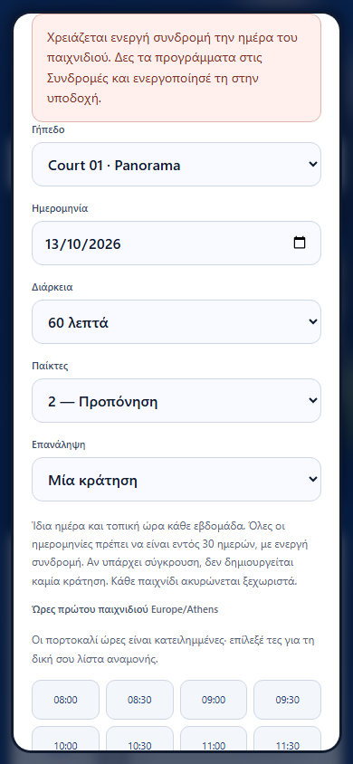

# New member experience walkthrough — 12 October 2026

The final walkthrough passed **17 real browser steps**, from a fresh visitor and public registration through reception activation, booking, playing with another member, cancellation, logout and re-login. No authentication or API transport was mocked. Three usability problems were corrected and installed in the local web container.

The main member completed registration and the subsequent workflow at **390×844**. The welcome page and supporting staff/partner sessions used desktop Chromium; authenticated navigation was also checked at **320px**. This is an automated and visually reviewed walkthrough, not a study with real users or physical phones.

## Journey and feedback

- Welcome links lead to the relevant club sections. The main action leads to Keycloak, where the visitor can register.
- Empty email and mismatched passwords produce field errors without creating an identity. Valid registration signs the member in through the actual PKCE flow.
- Onboarding prefills the name and account email, keeps the identity email read-only and requires a phone before saving. Newly registered members see profile-completion guidance rather than service-failure warnings.
- Membership information explains activation at reception and separates subscription fees from court charges. Reception records the already-paid test subscriptions through its real interface; the member then sees an active subscription.
- A booking shows the selected time and price per court before confirmation. Without an active subscription, the rejection is visible inside the dialog and explains the next step in Greek. No booking is created.
- The member books a free slot and sees the confirmed record. An occupied slot offers a personal waitlist without an automatic booking. Another member joins the open game and can withdraw.
- Cancellation persists, releases the slot and produces the real notifications. Mobile navigation, profile editing, logout and re-login retain the saved account data.
- One known cancellation question returned an AI answer with one authenticated citation without changing bookings. This does not resolve the previously documented AI availability and quality limitations.

## Corrections verified

| Finding                                                                                                  | Result                                                                                                                                                                                                                                                           |
| -------------------------------------------------------------------------------------------------------- | ---------------------------------------------------------------------------------------------------------------------------------------------------------------------------------------------------------------------------------------------------------------- |
| Clicking the authenticated logo changed a fragment but left the current tab open.                        | The logo returns to Overview through the normal tab handler, with an accessible name and keyboard activation.                                                                                                                                                    |
| Feedback outside a native modal could sit behind its backdrop.                                           | Dialog feedback now appears inside the open dialog, remains available while it is open, uses text content and announces errors. The subscription rejection includes a Greek reception instruction. Normal page notifications still work after the dialog closes. |
| A new member had no profile, so personal booking and notification requests produced misleading warnings. | Those requests wait for the profile, as subscriptions/invitations/waitlist already did. The expected profile absence prompts completion. Staff still load club bookings and notifications; real service failures and expired sessions retain their handling.     |



## Evidence and repeatability

The [dated summary](results/frontend/ux-walkthrough-2026-10-12.json) records the final journey, cleanup, regression results, source hashes and initial findings. The browser suite passed **69 checks** (23 scenarios at three viewports); the Node suite passed **95 tests**. Earlier [functional verification](USER-VERIFICATION.md), including its 54 stack checks, retains its original scope and results.

Run against the dedicated local `padel-e2e` stack, development `.env.example` credentials, installed Chromium and the optional local assistant stack:

```sh
node scripts/user-journey.mjs --experience
```

The default invocation retains the earlier journey using prepared identities. Experience mode registers the main member through the public form and uses setup identities for the partner/reception handoff. It writes a registration-email/fixture journal, sanitized results and screenshots under ignored `test-results/ux-walkthrough/`. Passwords and tokens remain in process memory. Cleanup runs in `finally`; after an abrupt termination, review the journal before removing only that run's fixtures.

All final cleanup checks passed: temporary identities were removed, test subscriptions/bookings/waitlist were cancelled and profiles disabled. Existing member, booking and subscription row fingerprints were unchanged. Synthetic inactive records remain as evidence. SMTP stayed in local Mailpit; no external email or online payment was processed.

## Remaining polish and limits

Keycloak registration/login and some notification text are still in English alongside the Greek application. Mobile booking tables scroll horizontally; the date/status/actions may require a swipe. These are worthwhile follow-up refinements.

This run exercised Chromium, not Safari/Firefox, screen readers or a full accessibility audit. It did not repeat backend integration, load, security or AI quality suites, execute GitHub workflows or publish the application. Only the local web container was rebuilt; backend schemas and services were unchanged.
